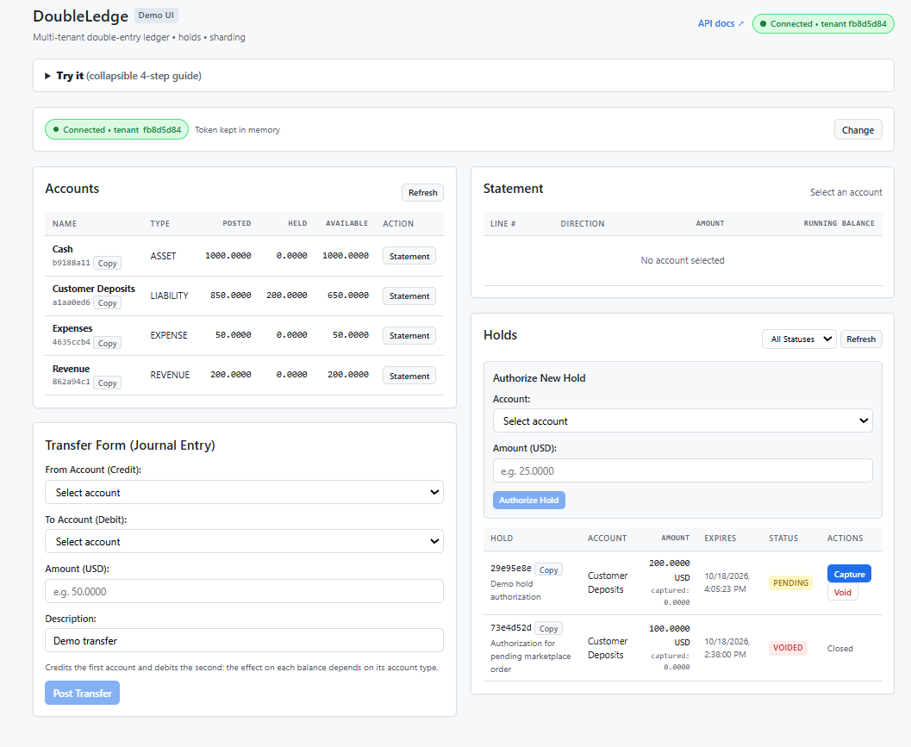
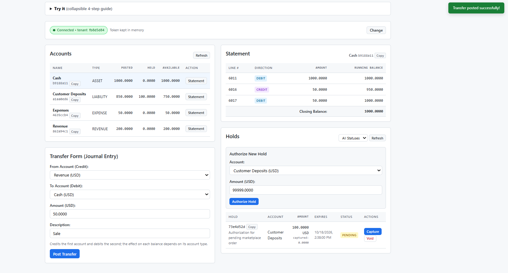
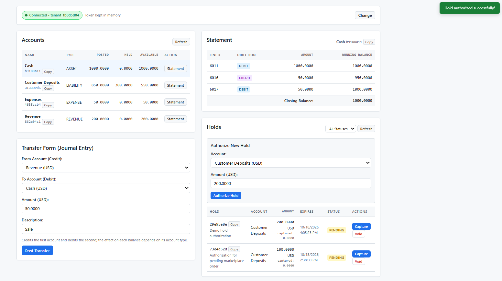
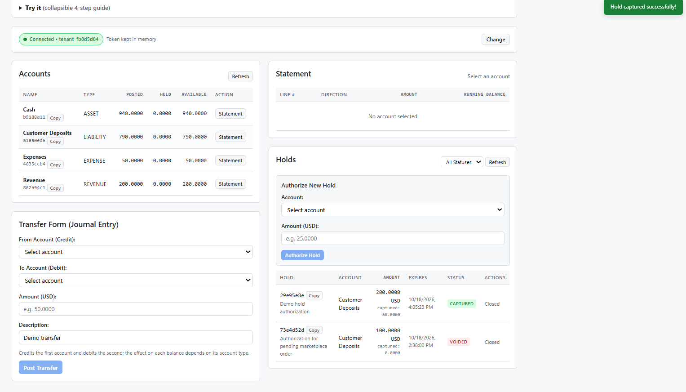
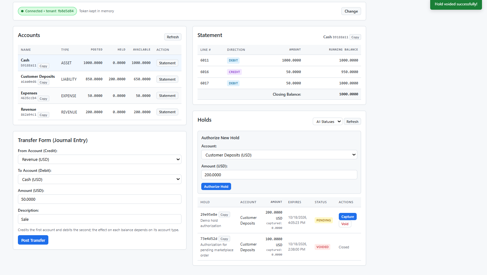
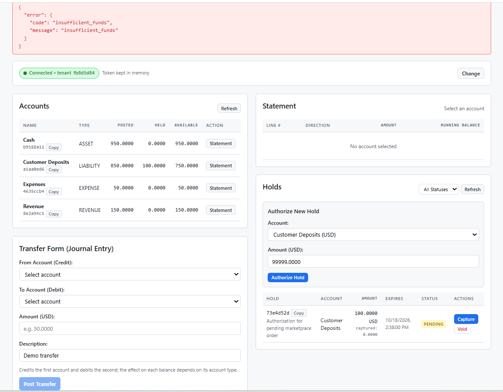

# DoubleLedge

**A multi-tenant, append-only, double-entry ledger service where correctness is enforced by the database, not by application code.**

DoubleLedge is an HTTP API for recording money movement for B2B platforms (marketplaces, SaaS billing, wallets). It is built around one idea: *the invariants of accounting should hold even if the application code is buggy, a worker is `kill -9`'d mid-request, or a developer forgets a filter.*

| Invariant | Enforced by |
| --- | --- |
| Every journal entry balances, per currency | Deferred constraint trigger (checked at `COMMIT`) |
| Posted entries can never change | Immutability triggers + revoked `UPDATE`/`DELETE` privileges |
| A retried request never posts twice | Idempotency row written in the *same* DB transaction as the entry |
| One tenant can never see or reference another's data | Postgres Row-Level Security + composite foreign keys |
| Stored balances always match the lines | Row locks on write + continuous reconciliation |

> **Scope Note:** The web tier is stateless and safe to scale or terminate at any time because every request operates within a single database transaction. The test suite explicitly verifies the enforcement of these invariants.

---

## Table of Contents

1. [Architecture](#architecture)
2. [Accounting Model](#accounting-model)
3. [Core Design](#core-design)
4. [Schema](#schema)
5. [API](#api)
6. [Features](#features)
7. [Quickstart](#quickstart)
8. [Testing Strategy](#testing-strategy)
9. [Benchmarks](#benchmarks)
10. [Trade-offs & Non-Goals](#trade-offs--non-goals)
11. [Roadmap](#roadmap)

---

## Architecture

```text
 Client ──HTTPS──► Load Balancer
                        │
                        ▼
        ┌───────────────────────────────┐
        │  Stateless API tier (Gunicorn) │  ← scale 0..N, safe to SIGKILL
        │  Django 5 + DRF                │
        │   • JWT auth → tenant context  │
        │   • Rate limiting (Redis)      │
        │   • Posting service            │
        └───────────┬───────────┬───────┘
                    │           │
        single atomic txn       │ read-through cache,
        (SET LOCAL tenant)      │ rate-limit counters
                    ▼           ▼
        ┌──────────────────┐  ┌───────────┐
        │  PostgreSQL 16   │  │  Redis    │  ← disposable: losing it
        │  source of truth │  │  cache    │    costs speed, never data
        └────────┬─────────┘  └───────────┘
                 │
                 ▼  (outbox rows, reconciliation)
        ┌───────────────────────────────┐
        │  Celery workers + beat         │
        │   • Webhook relay (outbox)     │
        │   • Reconciliation / checkpoints│
        │   • Idempotency key pruning    │
        └───────────────────────────────┘
```

### Stack

| Component | Choice | Why |
| --- | --- | --- |
| Language / framework | Python 3.12, Django 5, DRF | Mature ORM and migrations; `RunSQL` migrations for the Postgres-specific guarantees |
| Database | PostgreSQL 16 | Deferred constraint triggers, Row-Level Security, `SELECT ... FOR UPDATE [SKIP LOCKED]`, `JSONB` |
| Redis | Redis 7 | Response cache for completed idempotent requests and rate limiting. **Never required for correctness** |
| Background jobs | Celery | Webhook delivery, reconciliation, pruning |
| Packaging | Docker Compose | One command to run the whole stack locally and in CI |

**Deliberately not used: Redlock / distributed locks.** Postgres row locks and unique constraints already provide mutual exclusion for every write path. A Redis lock would add failure modes (clock drift, lease expiry mid-operation) without protecting anything Postgres doesn't.

---

## Accounting Model

### The equation

```
Assets + Expenses  =  Liabilities + Equity + Revenue
```

A live ledger must track all five account types, as the standard `Assets = Liabilities + Equity` equation only applies after closing revenue and expenses.

### Sign convention

Each line has a `direction` (`DEBIT` or `CREDIT`) and a strictly **positive** `amount`. Accounts store `balance` in their *normal-side* convention, so a healthy balance is positive for every account type:

| Account type | Normal side | Debit effect | Credit effect |
| --- | --- | --- | --- |
| Asset, Expense | Debit | `+amount` | `−amount` |
| Liability, Equity, Revenue | Credit | `−amount` | `+amount` |

### Negative balances are a per-account policy

Whether a negative balance is an error depends on the account. A customer wallet must not overdraw; a clearing or overdraft-allowed account may. Each account has `allow_negative BOOLEAN`, enforced by:

```sql
CHECK (allow_negative OR balance >= 0)
```

### Currency

Each account has exactly one ISO 4217 currency. An entry may span currencies only if it balances **within each currency**; FX is modeled via paired lines against a conversion account per currency. Amounts are validated against the currency's minor-unit exponent (e.g., JPY has 0 decimals, USD has 2, KWD has 3).

---

## Core Design

### 1. Balanced entries, enforced at commit

A plain `CHECK` constraint sees one row at a time and **cannot** express `SUM(debits) = SUM(credits)` across lines. DoubleLedge uses a **deferred constraint trigger**, which runs once at `COMMIT` after all lines are inserted, so a partially-built entry is allowed mid-transaction but can never be persisted.

```sql
CREATE FUNCTION assert_entry_balanced() RETURNS trigger AS $$
DECLARE
    v_entry_id uuid;
    v_lines    int;
    v_bad      record;
BEGIN
    v_entry_id := CASE TG_TABLE_NAME
        WHEN 'journal_entries' THEN NEW.id
        ELSE NEW.journal_entry_id
    END;

    SELECT count(*) INTO v_lines
      FROM transaction_lines WHERE journal_entry_id = v_entry_id;
    IF v_lines < 2 THEN
        RAISE EXCEPTION 'journal entry % needs at least 2 lines', v_entry_id
            USING ERRCODE = '23514';
    END IF;

    SELECT a.currency,
           SUM(CASE l.direction WHEN 'DEBIT' THEN l.amount ELSE -l.amount END) AS net
      INTO v_bad
      FROM transaction_lines l
      JOIN accounts a ON a.id = l.account_id
     WHERE l.journal_entry_id = v_entry_id
     GROUP BY a.currency
    HAVING SUM(CASE l.direction WHEN 'DEBIT' THEN l.amount ELSE -l.amount END) <> 0
     LIMIT 1;

    IF FOUND THEN
        RAISE EXCEPTION 'journal entry % unbalanced in % (net %)',
            v_entry_id, v_bad.currency, v_bad.net
            USING ERRCODE = '23514';
    END IF;
    RETURN NULL;
END;
$$ LANGUAGE plpgsql;

CREATE CONSTRAINT TRIGGER trg_entry_balanced_lines
    AFTER INSERT ON transaction_lines
    DEFERRABLE INITIALLY DEFERRED
    FOR EACH ROW EXECUTE FUNCTION assert_entry_balanced();

CREATE CONSTRAINT TRIGGER trg_entry_balanced_entry
    AFTER INSERT ON journal_entries      -- catches entries with zero lines
    DEFERRABLE INITIALLY DEFERRED
    FOR EACH ROW EXECUTE FUNCTION assert_entry_balanced();
```

The API also validates balance up front to return a friendly `422`; the trigger is the backstop that holds even for raw SQL, admin shells, or future code paths.

### 2. Append-only ledger

Ledgers are never edited. Mistakes are corrected with a **reversing entry** that links to the original.

* `BEFORE UPDATE OR DELETE` (row-level) and `BEFORE TRUNCATE` (statement-level) triggers on `journal_entries` and `transaction_lines` raise an exception.
* The application's database role is granted `INSERT`/`SELECT` only on those tables. Even a compromised app credential cannot rewrite history.
* Only `accounts.balance` (a derived cache, see below) is mutable, and only by the posting service.

### 3. Concurrency control

Postings run at `READ COMMITTED` with **explicit row locks**. This is sufficient because every read-modify-write on a balance happens while holding that account's row lock, and it avoids the retry storm of `SERIALIZABLE`.

```python
@transaction.atomic
def post_entry(tenant, payload):
    set_tenant(tenant.id)                         # SET LOCAL app.tenant_id
    cursor.execute("SET LOCAL lock_timeout = '2s'")

    account_ids = sorted({line.account_id for line in payload.lines})
    accounts = {
        a.id: a for a in
        Account.objects.select_for_update().filter(id__in=account_ids).order_by("id")
    }

    entry = JournalEntry.objects.create(...)
    TransactionLine.objects.bulk_create(...)
    apply_balance_deltas(accounts, payload.lines)  # enforces allow_negative via CHECK
    OutboxEvent.objects.create(type="entry.posted", ...)
```

* **Deterministic lock order.** Accounts are always locked in ascending primary-key order, which eliminates the classic *A→B vs B→A* lock-ordering deadlock between concurrent postings.
* **Deadlock Mitigation.** While deterministic lock ordering prevents deadlocks between concurrent postings, other interactions (e.g., foreign-key locks) may still deadlock. The service retries on `40P01` and `40001` with bounded attempts and jittered backoff, exposing the retry count as a metric.
* **Bounded waits.** `lock_timeout` returns a fast `503 Retry-After` to prevent request queueing during prolonged contention.
* **Hot accounts** (e.g. a platform fee account touched by every transaction) serialize on their row lock. This is a known trade-off, with a sub-account sharding strategy listed in the roadmap.

### 4. Idempotency that survives crashes and races

Every mutating request requires an `Idempotency-Key` header (UUID recommended; 16–128 URL-safe characters accepted).

**Atomic Idempotency:** The idempotency record is inserted in the same database transaction as the ledger write, guaranteeing that one cannot exist without the other.

```sql
CREATE TABLE idempotency_keys (
    tenant_id     uuid        NOT NULL,
    key           text        NOT NULL,
    request_hash  bytea       NOT NULL,          -- SHA-256 of method + path + canonical body
    response_code int,
    response_body jsonb,
    created_at    timestamptz NOT NULL DEFAULT now(),
    PRIMARY KEY (tenant_id, key)
);
```

Flow:

```text
1. BEGIN
2. INSERT INTO idempotency_keys (...) ON CONFLICT DO NOTHING
     ├─ inserted ─► post the entry, store response on the key row, COMMIT
     └─ conflict ─► (a concurrent twin blocks here until the first txn finishes)
          ├─ request_hash differs ───────────────► 422 idempotency_key_reuse
          ├─ response stored ────────────────────► replay it (header: Idempotent-Replayed: true)
          └─ first txn rolled back (row absent) ─► retry from step 2
3. If the process dies mid-request, the transaction rolls back and the key never existed.
   The client simply retries.
```

* Two concurrent requests with the same key: the second blocks on the unique index, then replays the first's stored response. This eliminates "processing" states and the need for orphaned key cleanup.
* **Redis** is an optional read-through cache for already-completed responses (24h TTL), purely to skip the database on common retries. If Redis is wiped, behavior is identical, just slower.
* `UNIQUE (tenant_id, reference_id)` on `journal_entries` is the long-term business-level dedupe (e.g. one entry per `ORDER_99283`), and it is **scoped per tenant**. A global unique constraint would let one tenant block another's reference IDs.
* Idempotency rows are pruned by a Celery job after a retention window (default 7 days).

### 5. Multi-tenant isolation (defense in depth)

Three independent layers, so a single mistake cannot cause a leak:

1. **Row-Level Security (the real boundary).** Every table has `tenant_id` and an RLS policy. It **fails closed**: if no tenant is set, the policy matches nothing.

   ```sql
   ALTER TABLE accounts ENABLE ROW LEVEL SECURITY;
   ALTER TABLE accounts FORCE ROW LEVEL SECURITY;
   CREATE POLICY tenant_isolation ON accounts
       USING      (tenant_id = nullif(current_setting('app.tenant_id', true), '')::uuid)
       WITH CHECK (tenant_id = nullif(current_setting('app.tenant_id', true), '')::uuid);
   ```

   The tenant is set per transaction with `SET LOCAL app.tenant_id`, which is safe under connection pooling (including PgBouncer transaction mode) because it cannot outlive the transaction.
2. **Composite foreign keys.** `transaction_lines (tenant_id, account_id)` references `accounts (tenant_id, id)`, so a line physically cannot point at another tenant's account, even with RLS off.
3. **Application manager.** A `TenantManager` filters by tenant using a `contextvars` value (not thread-locals, which leak under ASGI). This is convenience and early failure, not the security boundary.

The application connects as a dedicated role with **no `BYPASSRLS` and not the table owner**; migrations run under a separate owner role.

### 5b. Money handling

* `NUMERIC(19,4)` in the database; `Decimal` everywhere in Python.
* Amounts cross the API as **JSON strings**, and JSON numbers are rejected, so no float ever touches a value.
* `float` is banned by Ruff rules plus a custom AST check that fails the build if `FloatField` or a float literal appears in monetary code.

---

## Schema

Condensed DDL (Django models are generated to match; invariants live in `RunSQL` migrations).

```sql
CREATE TABLE tenants (id uuid PRIMARY KEY, name text NOT NULL);

CREATE TABLE accounts (
    id            uuid PRIMARY KEY,
    tenant_id     uuid    NOT NULL REFERENCES tenants(id),
    name          text    NOT NULL,
    type          text    NOT NULL CHECK (type IN ('ASSET','LIABILITY','EQUITY','REVENUE','EXPENSE')),
    currency      char(3) NOT NULL,
    balance       numeric(19,4) NOT NULL DEFAULT 0,   -- derived cache; lines are authoritative
    allow_negative boolean NOT NULL DEFAULT false,
    version       bigint  NOT NULL DEFAULT 0,
    UNIQUE (tenant_id, id),
    CHECK (allow_negative OR balance >= 0)
);

CREATE TABLE journal_entries (
    id            uuid PRIMARY KEY,
    tenant_id     uuid NOT NULL REFERENCES tenants(id),
    reference_id  text NOT NULL,
    description   text NOT NULL,
    reverses_id   uuid REFERENCES journal_entries(id),   -- set on reversing entries
    effective_at  timestamptz NOT NULL DEFAULT now(),    -- business time
    posted_at     timestamptz NOT NULL DEFAULT now(),    -- system time
    metadata      jsonb NOT NULL DEFAULT '{}',
    UNIQUE (tenant_id, reference_id),
    UNIQUE (tenant_id, id),
    UNIQUE (reverses_id)                                 -- an entry can be reversed once
);

CREATE TABLE transaction_lines (
    id               bigint GENERATED ALWAYS AS IDENTITY PRIMARY KEY,
    tenant_id        uuid NOT NULL,
    journal_entry_id uuid NOT NULL,
    account_id       uuid NOT NULL,
    direction        text NOT NULL CHECK (direction IN ('DEBIT','CREDIT')),
    amount           numeric(19,4) NOT NULL CHECK (amount > 0),
    FOREIGN KEY (tenant_id, journal_entry_id) REFERENCES journal_entries (tenant_id, id),
    FOREIGN KEY (tenant_id, account_id)       REFERENCES accounts (tenant_id, id)
);

CREATE TABLE outbox_events (          -- transactional outbox for webhooks
    id uuid PRIMARY KEY, tenant_id uuid NOT NULL, type text NOT NULL,
    payload jsonb NOT NULL, created_at timestamptz NOT NULL DEFAULT now(),
    delivered_at timestamptz, attempts int NOT NULL DEFAULT 0
);

CREATE TABLE ledger_checkpoints (     -- tamper-evidence, see Features
    id bigint GENERATED ALWAYS AS IDENTITY PRIMARY KEY,
    tenant_id uuid NOT NULL, up_to_line_id bigint NOT NULL,
    batch_hash bytea NOT NULL, prev_hash bytea, created_at timestamptz NOT NULL DEFAULT now()
);
```

`accounts.balance` is a **denormalized cache** maintained inside the posting transaction under the row lock. The lines are the source of truth, and reconciliation continuously proves the two agree.

---

## API

All endpoints are under `/api/v1`, authenticated with a short-lived RS256 JWT carrying a `tenant_id` claim.

| Method | Path | Purpose |
| --- | --- | --- |
| `POST` | `/journal-entries/` | Post a balanced entry (idempotent) |
| `GET` | `/journal-entries/{id}/` | Fetch an entry with its lines |
| `POST` | `/journal-entries/{id}/reverse/` | Post a reversing entry (idempotent) |
| `GET` | `/accounts/{id}/` | Account and current balance |
| `GET` | `/accounts/{id}/balance/?as_of=<ts>` | Historical balance (point-in-time) |
| `GET` | `/accounts/{id}/statement/` | Cursor-paginated lines with running balance |
| `POST` | `/webhook-endpoints/` | Register a webhook (HMAC-signed deliveries) |

### Example: customer pays for an order

A platform holds customer funds as a liability (what it owes the customer). Paying a merchant **debits** the customer wallet (liability decreases) and **credits** the merchant payable (liability increases).

```bash
curl -X POST http://localhost:8000/api/v1/journal-entries/ \
  -H "Authorization: Bearer <tenant_jwt>" \
  -H "Idempotency-Key: 9b1deb4d-3b7d-4bad-9bdd-2b0d7b3dcb6d" \
  -H "Content-Type: application/json" \
  -d '{
    "reference_id": "ORDER_99283",
    "description": "Order payment: customer to merchant",
    "lines": [
      { "account_id": "6f1c0a9e-...-user-wallet",  "amount": "500.00", "direction": "DEBIT"  },
      { "account_id": "c2a7d3b1-...-merchant-pay", "amount": "500.00", "direction": "CREDIT" }
    ]
  }'
```

### Error contract

| Status | `code` | Meaning |
| --- | --- | --- |
| `201` | n/a | Posted. Replays return the original body plus `Idempotent-Replayed: true` |
| `400` | `missing_idempotency_key` | Header absent or malformed |
| `409` | `reference_conflict` | `reference_id` already used by a different request |
| `422` | `idempotency_key_reuse` | Same key, different payload |
| `422` | `unbalanced_entry` | Debits ≠ credits (per currency) |
| `422` | `insufficient_funds` | Would breach `allow_negative = false` |
| `422` | `currency_mismatch` | Line amount invalid for the account's currency |
| `429` | `rate_limited` | Per-tenant token bucket exceeded |
| `503` | `lock_timeout` | Hot-account contention; retry per `Retry-After` |

---

## Features

**Core**

* Double-entry postings with DB-enforced balance, per currency
* Append-only history with linked **reversing entries** (an entry can be reversed exactly once)
* Per-account overdraft policy (`allow_negative`)
* Distributed-safe idempotency with request-body fingerprinting
* RLS-based tenant isolation with composite-FK cross-tenant protection
* Cursor-paginated **account statements** with running balance

**Reliability & integrity**

* **Reconciliation job** (Celery beat, plus `manage.py check_ledger_integrity`), run inside a `REPEATABLE READ` snapshot for a consistent view. It verifies, per tenant and currency:
  1. Total debits = total credits across all lines
  2. Each `accounts.balance` equals the balance recomputed from its lines
  3. The checkpoint hash chain is intact
  
  Failures raise an alert and a metric; the check can also `--repair` the cache (never the lines).
* **Tamper-evident checkpoints.** Periodically, each tenant's newly-posted lines are hashed into a batch hash chained to the previous checkpoint. A hash chain on *every* write would serialize all postings per tenant, so DoubleLedge seals in batches instead. Any later edit to history breaks the chain on the next verification.
* **Point-in-time balances** using `effective_at` and periodic balance snapshots to avoid scanning full history.

**Integrations**

* **Transactional outbox → webhooks.** Events are written in the same transaction as the posting (no lost or phantom events). A Celery relay claims rows with `FOR UPDATE SKIP LOCKED`, signs the payload with HMAC-SHA256, and retries with exponential backoff. Delivery is **at-least-once**; consumers dedupe on `event.id`.

**Operability**

* Structured JSON logs with request and tenant IDs
* Prometheus metrics: posting latency, lock wait time, deadlock retries, idempotent replays, reconciliation drift (should always be 0)
* OpenTelemetry tracing across API → DB → Celery
* Per-tenant rate limiting (Redis token bucket)
* OpenAPI schema and a Swagger UI at `/api/docs/`

---

## Quickstart

Requires Docker with Compose v2.

```bash
git clone https://github.com/<you>/doubleledge && cd doubleledge
cp .env.example .env        # PowerShell: Copy-Item .env.example .env
make demo
```

`make demo` generates a dev JWT keypair, starts the stack, creates a demo
tenant, seeds sample data, and prints the tenant id and a token. Open
http://localhost:8000/demo/ and paste the token.

No `make` (e.g. Windows)? These three commands are exactly what it runs:

```bash
docker compose run --rm --no-deps owner python scripts/gen_dev_keys.py
docker compose up -d --wait
docker compose run --rm owner python manage.py demo_bootstrap
```

Open `http://localhost:8000/demo/` in your browser and paste the printed dev JWT token to explore.

<p align="center">
  
</p>

## Demo walkthrough

The demo UI at `/demo/` is a single static page over the public API.

**1. A transfer moves both sides.** Revenue → Cash for 50.0000. Both balances
update and the statement gains a line with a running balance.
<p align="center">
  
</p>

**2. A hold reserves funds without posting them.** Authorizing 200.0000 on
Customer Deposits raises Held to 300 and lowers Available to 550, while Posted
stays at 850.
<p align="center">
  
</p>

**3. Capturing part of a hold releases the remainder.** Capturing 60.0000 of the 200.0000 hold credits Cash for 60.0000 and immediately releases the remaining 140.0000 back to Available.
<p align="center">
  
</p>

**4. Voiding a hold restores Available balance.** Voiding the 100.0000 hold marks it VOIDED and immediately drops Held by 100.0000, returning the reserved funds to Available.
<p align="center">
  
</p>

**5. Overdraft policy rejects excess holds.** Authorizing 99,999.0000 against Customer Deposits is rejected with `insufficient_funds` without posting anything or modifying balances.
<p align="center">
  
</p>

### Automated Stress Demo & Invariant Verification

```bash
make stress     # seeds a tenant, fires 1,000 concurrent transfers, prints the integrity report
```

`make stress` finishes in about a minute and ends with output like:

```text
Posted 1000 entries across 20 accounts (8 threads, hot-account contention on)
Deadlock retries: <n>   Idempotent replays: <n>
Integrity check: debits == credits ✔   balances == recomputed ✔   checkpoint chain ✔
```

### CLI & API Exploration

Alternatively, provision tenants and query endpoints directly:

```bash
# 1. Provision a demo tenant and get a dev JWT (valid for 24 hours)
docker compose run --rm owner python manage.py create_tenant --name="Acme Corp"

# 2. Seed chart of accounts, sample transactions, and a hold
docker compose run --rm owner python manage.py seed_demo --tenant_id=<TENANT_ID>

# 3. Query seeded account details via the API using the dev token
curl -H "Authorization: Bearer <TOKEN>" http://localhost:8000/api/v1/accounts/<ACCOUNT_ID>/

# 4. Retrieve the seeded hold status
curl -H "Authorization: Bearer <TOKEN>" http://localhost:8000/api/v1/holds/<HOLD_ID>/
```

Other commands:

```bash
make stress       # 1,000 concurrent transfers + integrity report
make test         # full suite
make integrity    # manage.py check_ledger_integrity
make bench        # load & concurrency benchmark
make stop         # stop containers, keep data
make down         # stop and WIPE data
```

---

## Testing Strategy

Each invariant in the table at the top has at least one test that tries to break it.

| Invariant | How it's tested |
| --- | --- |
| Balanced entries | Insert unbalanced lines via **raw SQL** and assert `COMMIT` fails with `23514`; also test 0- and 1-line entries |
| Immutability | Attempt `UPDATE`/`DELETE`/`TRUNCATE` as the app role; assert failure |
| Concurrency | N threads transfer between a small set of hot accounts (`pytest-django`, `transaction=True`, real Postgres); assert **no lost updates** and `Σ balances` unchanged |
| Deadlocks | Opposed-order transfers (A→B and B→A) executed concurrently under high load; assert none surface to the client |
| Idempotency race | Fire the same key concurrently from many threads; assert exactly one entry and identical responses |
| Idempotency misuse | Same key + different body returns `422` |
| Crash safety | `SIGKILL` the API process mid-posting in a loop; assert no partial entries and that retries succeed |
| Tenant isolation | Cross-tenant reads, writes, and line→account references all fail, including with the Django manager bypassed |
| Property-based | **Hypothesis** generates random sequences of postings and reversals; invariants (balance equality, non-negativity, reconciliation) hold after every sequence |
| Reconciliation | Simulate cached balance corruption and assert the job detects it |

**CI:** GitHub Actions runs Ruff, Black, mypy (strict on money-handling modules), the custom float-ban check, then the full suite against a real Postgres 16 service container.

### Database Roles & Test Isolation

* **Runtime vs Migration Roles:** The API and Celery workers connect as `ledger_runtime` (a restricted role without superuser or `BYPASSRLS`). Migrations run via a dedicated migration step as `postgres`. A startup guard rejects startup if the default runtime connection is superuser/`BYPASSRLS`.
* **RLS Test Markers:** Standard functional, unit, and invariant tests run under the test database owner (`postgres`). Tests specifically verifying RLS policies, role boundaries, and cross-tenant leakage are marked with `@pytest.mark.runtime_role` to execute under `SET ROLE ledger_runtime`.
* **Tenant Creation Monkeypatch (`tests/conftest.py`):** `Tenant.objects.create` is globally monkeypatched at import time to execute under `RESET ROLE` and restore the active role in a `finally` block. Because `tenants` is an administrative table protected by RLS and not writable by `ledger_runtime`, test fixture provisioning requires elevating to the database owner.

---

## Benchmarks

Reproduce with `make bench`.

| Scenario | Concurrency | Throughput | p50 | p99 | Balance drift |
| --- | --- | --- | --- | --- | --- |
| Spread across 10k accounts | 16 | 80.0 tx/s | 193.9 ms | 311.3 ms | 0 |
| 100 accounts | 16 | 73.8 tx/s | 209.1 ms | 306.3 ms | 0 |
| Single hot account (worst case) | 16 | 70.3 tx/s | 268.0 ms | 460.3 ms | 0 |

The hot-account row is intentionally included: it shows the honest ceiling of row-lock serialization and motivates the sharding item in the roadmap.

---

## Trade-offs & Non-Goals


* **Row locks over `SERIALIZABLE`:** simpler and predictable under contention, at the cost of hot-account serialization.
* **Cached balances over computed-on-read:** O(1) reads, but needs reconciliation to prove correctness.
* **Shared schema + RLS over schema-per-tenant:** scales to many tenants with simple migrations; noisy-neighbor isolation is weaker.
* **Batched checkpoints over per-write hash chain:** preserves write concurrency; tamper detection is delayed until the next seal.
* **At-least-once webhooks:** exactly-once delivery isn't possible over HTTP; consumers must dedupe.
* **Non-goals:** payment processing / card rails, KYC, tax, a UI beyond the demo, and regulatory certification. DoubleLedge is the *ledger*, not a payments company.

---

## Known Gaps & Future Hardening

* **Foreign Keys:**
  * Single-column FKs: `balance_snapshots.account_id`, `balance_snapshots.entry_id`, `journal_entries.reverses_id`
  * No FKs at all on `outbox_events`, `idempotency_keys`, `ledger_checkpoints`
* **Sharding Constraints:**
  * No `shard_count` immutability trigger, and no shard-side `allow_negative` CHECK
* **Holds Invariant:**
  * Hold invariant (option 1: `held_amount` plus a DB CHECK), `released_amount` in void/expire webhook payloads
* **Idempotency Race:**
  * **Idempotency race (unconfirmed):** an unreviewed red-team test once reported a balance delta of 200 for a single entry. The original output was not preserved. It was not reproduced in 100 concurrent same-key scenarios (sharded and unsharded) or 40 runs of a faithful re-creation of the original test, all run as the DB owner. Cause unconfirmed; no code change was made.
* **Database Roles & Permissions:**
  * Default privileges: tables created by migrations after 0012 do not automatically inherit `ledger_runtime` grants unless `ALTER DEFAULT PRIVILEGES` is configured or each new migration adds grants
  * Sequences: granted `USAGE, SELECT` (no `UPDATE` to prevent `setval` sequence resets)
  * Immutability assertion: add CI test checking `has_table_privilege('ledger_runtime', 'journal_entries', 'UPDATE')` returns false
  * Role inspection in apps.py: currently runs on ready() check; idiomatic refactor to register as a Django system check (`manage.py check --deploy`)
* **Test Isolation & Roles:**
  * Red-team tests are unreviewed, so they stay on a separate branch until converted to `xfail(strict=True)`
  * Most tests run as the owner (`postgres`), and only the RLS/role-specific tests run as `ledger_runtime`
  * Concurrency tests run as the DB owner (`postgres`) to avoid fixture setup failures under session-level `SET ROLE`
  * Central `Tenant.objects.create` monkeypatch in `tests/conftest.py` temporarily resets role to owner during tenant provisioning so fixtures can set up records safely

---

## Roadmap

* [x] ~~**Holds / two-phase postings:** authorize → capture/release, with `available_balance = balance − active holds`~~
* [x] ~~**Hot-account sharding:** split a hot account into N sub-accounts with periodic sweep~~
* [ ] **Read replicas** for statements and point-in-time queries
* [ ] **Multi-currency FX helper:** rate-stamped conversion entries
* [ ] **Per-tenant encryption of `metadata`** and signed audit exports
* [ ] **Scheduled period close** (freeze `effective_at` before a cutoff)

---

## Repository Layout

```text
doubleledge/
├── ledger/            # models, posting service, reconciliation
│   ├── migrations/    # includes RunSQL for triggers, RLS, grants
│   └── services/
├── api/               # DRF views, serializers, idempotency, auth
├── workers/           # Celery tasks: outbox relay, checkpoints, pruning
├── tests/             # unit, race, crash, property-based, isolation
├── scripts/           # demo.py, load tests
└── docker-compose.yml
```


